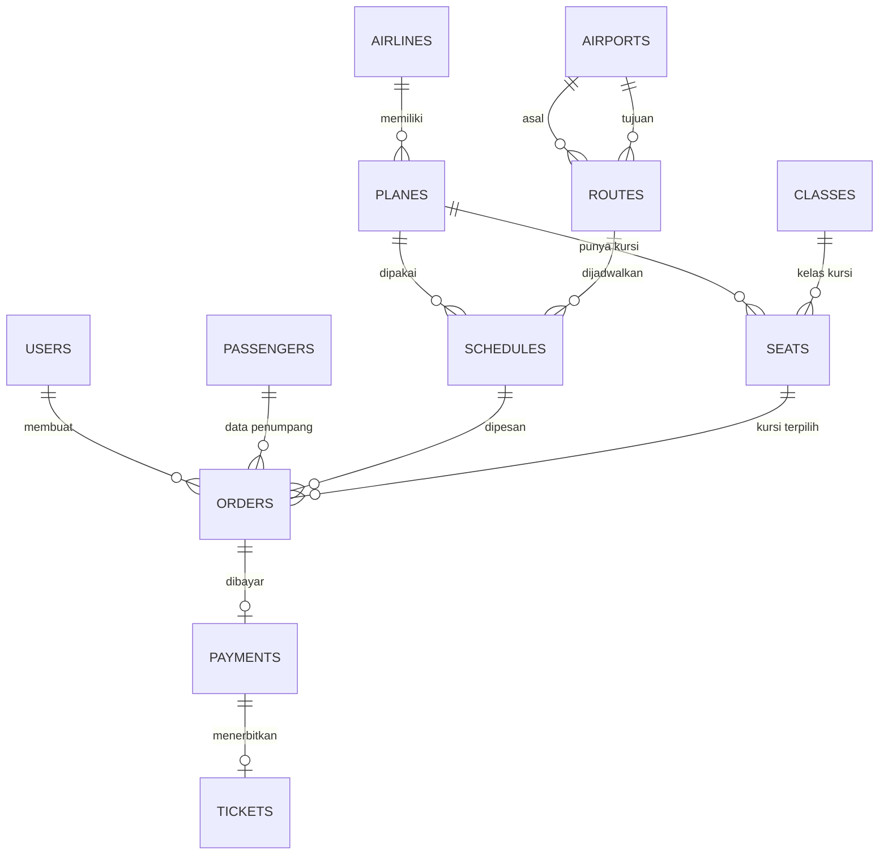

# Altaayirat - Sistem Pemesanan Tiket Pesawat

Aplikasi web pemesanan tiket pesawat berbasis **Laravel (Blade) + MySQL + Tailwind CSS**. Pengguna mencari jadwal, memilih kursi, memesan, lalu menerima e-tiket setelah pembayaran dikonfirmasi staff. Proyek ini adalah pembangunan ulang dari versi lama berbasis PHP native, dengan fokus pada keamanan, kode yang rapi, dan pengujian otomatis.

## Daftar Isi

- [Fitur](#fitur)
- [Tech Stack](#tech-stack)
- [Alur Pemesanan](#alur-pemesanan)
- [Peran dan Hak Akses](#peran-dan-hak-akses)
- [Keamanan](#keamanan)
- [Skema Database](#skema-database)
- [Instalasi Lokal](#instalasi-lokal)
- [Menjalankan Test](#menjalankan-test)
- [Keputusan Desain](#keputusan-desain)
- [Keterbatasan yang Diketahui](#keterbatasan-yang-diketahui)
- [Rencana Berikutnya](#rencana-berikutnya)
- [Latar Belakang](#latar-belakang)

## Fitur

**Untuk pengguna**
- Registrasi dan login (password di-hash, validasi password kuat)
- Pencarian jadwal berdasarkan bandara asal, tujuan, dan tanggal
- Pemilihan kursi per kelas (Economy, Premium Economy, Business) dan pengisian data penumpang
- Halaman status pesanan dan e-tiket digital (hanya bisa dibuka oleh pemilik pesanan)
- Ganti password lewat halaman "Lupa password" (versi sederhana, lihat [Keterbatasan](#keterbatasan-yang-diketahui))

**Untuk staff (`admin` / `penjual`)**
- Panel konfirmasi pembayaran: lunas (tiket dibuat otomatis) atau tolak
- CRUD data master: Maskapai, Bandara, Pesawat, Rute, Jadwal
- Pembuatan kursi otomatis saat menambah pesawat (jumlah per kelas), dan halaman daftar kursi
- Penghapusan data master diblokir selama masih dipakai data lain

**Umum**
- Antarmuka responsif dengan tema cokelat dan kuning (Tailwind CSS)
- Halaman error kustom: 403, 404, 419, 500, 503
- Pesan sukses dan gagal terpusat di satu komponen
- 73 automated test

## Tech Stack

| Bagian | Teknologi |
|---|---|
| Framework | Laravel 13 (PHP 8.3+, dikembangkan dengan 8.4) |
| Tampilan | Blade, Tailwind CSS v4, Vite |
| Database | MySQL (SQLite in-memory untuk test) |
| Autentikasi | Session-based, middleware `auth`, `guest`, dan `staff` (kustom) |
| Test | Pest sebagai test runner |

## Alur Pemesanan

```
Cari jadwal -> Pilih kursi + isi data penumpang -> Order dibuat
   (publik)            (login wajib)              (pembayaran: menunggu_konfirmasi)
                                                          |
        E-tiket terbuka  <-  Staff konfirmasi "lunas"  <--+
        (pemilik saja)       (tiket TIX-xxxx dibuat)       +--> "ditolak" (tanpa tiket)
```

Satu pemesanan membuat empat perubahan dalam satu transaksi database: penumpang, order, pembayaran (status `menunggu_konfirmasi`), dan penandaan kursi sebagai `dipesan`.

## Peran dan Hak Akses

| Peran | Akses |
|---|---|
| Tamu | Beranda, pencarian jadwal, registrasi, login, lupa password |
| `user` | Semua akses tamu + memesan, melihat pesanan dan tiket **miliknya sendiri** |
| `admin` / `penjual` | Semua akses `user` + `/admin/konfirmasi` dan CRUD `/admin/airlines`, `/admin/airports`, `/admin/planes`, `/admin/routes`, `/admin/schedules` |

Staff tidak otomatis boleh membuka pesanan atau tiket milik pengguna lain. Itu ditegakkan di controller dan diuji.

Untuk menjadikan sebuah akun sebagai staff (belum ada UI manajemen user):

```bash
php artisan tinker
>>> \App\Models\User::where('email', 'emailmu@contoh.com')->update(['role' => 'admin']);
```

Pendaftaran lewat form selalu menghasilkan role `user`. Mengirim `role=admin` di request diabaikan, dan ini diuji.

## Keamanan

Versi lama memiliki celah serius. Perbandingannya:

| Masalah di versi lama | Penanganan di versi ini |
|---|---|
| SQL Injection (query dirangkai dari input) | Eloquent dan query builder dengan parameter terikat |
| Password disimpan plaintext | Cast `hashed` pada model User (bcrypt) |
| Halaman admin tanpa otorisasi | Middleware `auth` + `staff`, tamu dialihkan ke login dan user biasa mendapat 403 |
| Pesanan dan tiket bisa dibuka dengan menebak ID (IDOR) | Pengecekan kepemilikan di `OrderController` dan `TicketController` |
| Dua orang bisa memesan kursi yang sama | Transaksi + `lockForUpdate()` pada baris kursi |
| Kursi pesawat lain bisa diselipkan ke pesanan | Kursi dicek milik pesawat pada jadwal yang dipesan |
| Pembayaran bisa dikonfirmasi berkali-kali (tiket ganda) | Status dicek ulang di dalam transaksi dengan kunci baris |
| Pesan login membocorkan email yang terdaftar | Satu pesan umum untuk email salah dan password salah |
| Role bisa dipilih sendiri saat daftar | Role diset di server, input dari form diabaikan |
| Menghapus data induk ikut menghapus order dan tiket (cascade) | Guard sebelum hapus di setiap controller master |

Semua poin di atas punya test otomatis. Lihat [Menjalankan Test](#menjalankan-test).

## Skema Database



Beberapa catatan skema:
- `routes` punya dua foreign key ke `airports` (`departure_airport_id` dan `arrival_airport_id`).
- `seats` unik per `(plane_id, seat_number)`, dan `seats.status` bernilai `tersedia`, `dipesan`, atau `tidak_tersedia`.
- `payments.status` bernilai `menunggu_konfirmasi`, `lunas`, atau `ditolak`. `tickets.ticket_code` unik.
- Hampir semua foreign key memakai `cascadeOnDelete()`, sehingga penghapusan dijaga di level aplikasi (lihat [Keputusan Desain](#keputusan-desain)).

## Instalasi Lokal

**Prasyarat:** PHP 8.3+, Composer, Node.js dan npm, MySQL atau MariaDB.

```bash
git clone https://github.com/farrelspratama/Altaayirat.git
cd altaayirat
composer install
npm install
cp .env.example .env
php artisan key:generate
```

Buat database kosong, atur koneksinya di `.env` (`DB_DATABASE`, `DB_USERNAME`, `DB_PASSWORD`), lalu:

```bash
php artisan migrate --seed
npm run dev
php artisan serve
```

Buka `http://127.0.0.1:8000`. Jika memakai Laravel Herd atau Valet, cukup buka domain lokal proyeknya.

**Data awal (seeder):** 6 bandara, 5 maskapai, 3 kelas kursi, 3 pesawat lengkap dengan kursinya, serta rute dan jadwal contoh. Seeder bersifat idempotent, jadi aman dijalankan ulang. Akun belum ikut di-seed: daftar lewat form, lalu jadikan staff dengan perintah `tinker` di bagian [Peran dan Hak Akses](#peran-dan-hak-akses).

## Menjalankan Test

```bash
php artisan test
```

Test memakai SQLite in-memory (ekstensi `pdo_sqlite` harus aktif), sehingga database MySQL tidak tersentuh dan `npm run build` tidak diperlukan.

| Kelompok | Yang diuji |
|---|---|
| Autentikasi | Hash password, role tidak bisa dipilih sendiri, pesan login seragam, logout, redirect |
| Akses staff | Setiap halaman admin: tamu ke login, user biasa 403, admin dan penjual masuk |
| Pemesanan | Alur sukses, kursi terpakai ditolak, kursi pesawat lain ditolak, validasi form, `user_id` palsu diabaikan |
| Otorisasi (IDOR) | Pesanan dan tiket orang lain mendapat 403, tiket belum lunas mendapat 404 |
| Pembayaran | Lunas membuat tiket, tolak tidak, konfirmasi ganda dicegah, alur dari pesan sampai tiket |
| Data master | Kursi otomatis, penomoran kursi, guard hapus untuk semua entitas |

## Keputusan Desain

- **Laravel Blade monolit, bukan REST API + SPA.** Untuk proyek solo dengan satu antarmuka, monolit lebih cepat dibangun dan lebih sederhana di-deploy. Controller tetap tipis dan aturan bisnis ada di model, jadi memisahkannya menjadi API di kemudian hari tidak memerlukan penulisan ulang.
- **Tailwind CSS dengan token warna sendiri.** Palet `brand` (turunan `#A7672D`), `accent`, dan `canvas` didefinisikan sekali di `@theme`, sehingga mengganti tema cukup di satu tempat.
- **Pengaman kursi berlapis.** Validasi form, pengecekan kepemilikan kursi terhadap pesawat, lalu `lockForUpdate()` dalam transaksi supaya pemesan serentak mengantre, bukan lolos bersamaan.
- **Penghapusan dijaga di aplikasi.** Karena foreign key memakai `cascadeOnDelete()`, menghapus bandara yang dipakai rute akan menghapus rute, jadwal, order, pembayaran, dan tiket. Karena itu setiap `destroy()` memeriksa data turunan terlebih dahulu dan menolak dengan pesan yang jelas.
- **Kursi dibuat otomatis, tetapi tidak bisa diubah.** Jumlah kursi hanya diisi saat membuat pesawat. Mengubah jumlah setelah ada pesanan berisiko merusak data order.
- **Peran sebagai kolom `role`.** Cukup untuk tiga peran. Jika kebutuhannya berkembang, bisa diganti dengan tabel izin.
- **Nama model yang menghindari bentrok.** `FlightClass` (tabel `classes`) karena `Class` adalah kata kunci PHP, dan model `Route` di-alias menjadi `FlightRoute` agar tidak bertabrakan dengan facade `Route`.
- **Seeder idempotent** (`updateOrCreate`) dan migration sebagai satu-satunya sumber skema.

## Keterbatasan yang Diketahui

Dicatat terbuka agar tidak ada yang dianggap sudah selesai padahal belum.

- **Lupa password versi sederhana.** Pengguna cukup memasukkan email dan password baru, tanpa token atau verifikasi email. Siapa pun yang tahu email sebuah akun bisa mengganti passwordnya. **Jangan di-deploy seperti ini.** Alur berbasis token dan email sudah dirancang dan perlu dipasang sebelum produksi.
- **Status kursi bersifat global per kursi, bukan per jadwal.** Satu pesawat yang terbang di dua tanggal berbeda berbagi status kursi, sehingga kursi yang dipesan untuk satu tanggal tampil terisi untuk tanggal lain. Perbaikan yang benar adalah menghitung ketersediaan per jadwal dari tabel `orders`.
- **Pembayaran yang ditolak tidak membebaskan kursinya.**
- **Kursi tidak bisa ditambah atau diedit** setelah pesawat dibuat.
- **Race condition diuji secara berurutan, bukan serentak.** Test membuktikan kursi yang sudah dipesan ditolak untuk pemesan berikutnya. SQLite dalam satu proses tidak dapat membuktikan bahwa `lockForUpdate()` menahan dua permintaan yang benar-benar bersamaan. Itu memerlukan uji beban terpisah pada MySQL.
- **Pembayaran masih manual.** Staff mengonfirmasi lewat panel, belum ada payment gateway.
- **Belum ada pagination** pada tabel admin, dan belum ada UI manajemen user.

## Latar Belakang

Proyek ini adalah pengembangan ulang dari aplikasi Altaayirat versi lama (PHP native + MySQL) yang dibangun bersama rekan semasa kuliah. Versi lama dianalisis secara menyeluruh: struktur, alur, dan celah keamanannya. Hasil analisis itulah yang mendasari tabel di bagian [Keamanan](#keamanan). Pembangunan ulang ini dikerjakan sebagai proyek belajar dan portofolio, dengan praktik yang umum dipakai di industri: migration dan seeder, form request, otorisasi eksplisit, transaksi database, Git dengan pesan commit konvensional, dan test otomatis.
